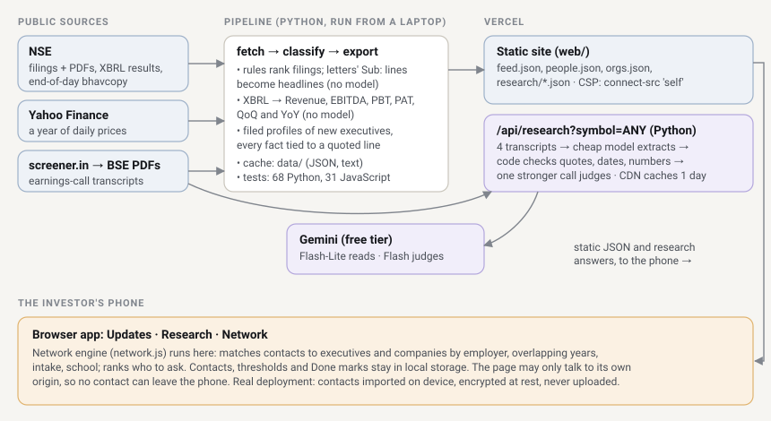

**To:** assessment@enam.com
**Subject:** IIT Kanpur – Founding AI Engineer - 2027

Hello ENAM team,

Here is my submission for the FINN challenge.

- **Prototype (open on a phone):** https://finn-founding.vercel.app
- **Repository:** https://github.com/utkarshk23iitk/Finn-founding
- **AI build history:** [Claude Code session export, attached]

## What I built

FINN is one idea in three views: **every item ends with a person.** It tells
you what changed, why it matters, and who in your own network can explain it.

**Updates (Push).** A short queue with an end, not a feed: "6 things need you",
a Done button on each card, then one-liners worth a glance, then the routine
paperwork folded into counts. 280 real NSE filings across an 18-company
portfolio are ranked by rules, not a model.

- When NSE's description is generic, FINN reads the filing letter itself.
  That changed real rankings: CG Power's "Action(s) taken or orders passed"
  was a pollution board order to close a plant, stayed by the High Court the
  next day; Bharti Airtel's five filings under the same title were routine
  telecom-department notices.
- Results cards show Revenue, EBITDA, PBT and PAT, QoQ and YoY, read by code
  from each filing's XBRL, with a line written from the numbers: "Alkem:
  Revenue +13.8% YoY, PAT −14.4% · tax took 33% of PBT against 13% a year
  ago."
- Leadership changes show the incoming person's profile from the company's
  own filing, and your best route to them: for Apollo Tyres' new CFO, a
  contact who spent 2008–2016 in KPMG's tax practice with him.
- Each card lists the company's other material filings that month, so
  Alkem's new CFO sits next to its forensic audit and its new CEO.
- Price and volume alerts use your thresholds (volume against the 20-day
  median, so one results day can't hide the next spike), and join the filing
  that explains them. A move nothing explains says so.

**Research (Pull).** Promised vs delivered for any NSE ticker, from its last
four earnings calls only. Infosys delivered both FY26 promises (3.1% growth
against 3–3.5%, a 21% margin against 20–22%) but cut its FY27 growth guidance
twice, from 1.5–3.5% to 1–2%. Dixon cut its telecom target from ₹7,500–8,000
crore to ₹6,700–7,000 crore. CreditAccess Grameen raised its FY27 profitability
guidance across the board. Any other ticker is read on demand, in 9 to 50
seconds depending on how busy Gemini's free tier is (Britannia 9s, Asian
Paints 14s, L&T 51s); a company that sets no explicit targets (TCS, Britannia)
is told so, which is a finding in itself. The page leads with how many settled
promises were delivered, shows misses first, and tracks each promise across
the four calls, so a quietly changed target is visible. Every quote opens to
the transcript.

**Network.** Woven into both views above, and also asked directly: type a
company, a theme or a person. "Amber" returns the contact who ran the plant
of the company Amber just took over. A route always shows two separate
signals: how well the contact knows the person or company, and how long
since you last spoke. "Worth a call" suggests stale contacts whose company
just had news.

## Key decisions

1. **Code does what code can do.** Ranking, headlines, results maths,
   network matching, deadlines and numeric verdicts are code. A model is
   used only to read transcripts, where reading is the job.
2. **Checks decide trust, not the model.** Every quote from a transcript or
   filing must appear word for word; facts about real people carry the
   filing line they rest on (43 checks). In the final research, 3 quotes
   the model returned were not in the transcripts and were dropped, and code
   overruled 2 verdicts: one compared a target with a different business's
   number, one missed a target that management's own words show had changed.
3. **Facts about real people come only from their filings.** Some filed
   profiles are rich, some name no past employer (Alkem's new CEO and CFO).
   When a profile is thin, FINN says so and points to who knows the company,
   instead of filling the gap.
4. **Built for a morning scan.** One card per company and category, one
   contact per card with the rest a tap away, leadership filings as one
   line each ("Jayant Balan named MD"), routine filings as counts.
5. **The first research run was plausible and wrong.** Dixon guides per
   business; the model judged a segment's ₹5,500–6,000 crore target
   "delivered" against company revenue of ₹48,893 crore, and merged three
   businesses' targets into one fake revision. Reading every verdict against
   the transcript found it; the fix was a segment field, sentences from later
   calls for the judge, and a code check that won't compare numbers 3x apart.

## Architecture

**Data pipelines.** Python, run from a laptop, writes a cache (`data/`) and
static JSON for the app. NSE gives filings for the whole market in one
request per week (filtered to the portfolio; it matched per-company requests
exactly), each quarter's results as XBRL, and the end-of-day bhavcopy, which
fills the latest day that Yahoo leaves without a close. Transcripts come
from the links screener.in lists, which point to the company's own filings.
Names are linked across sources with an alias map for companies and schools
and a name rule (surname plus compatible initials) that also needs a shared
employer, so a common name can't make a false match.

**Data security and privacy.** The investor's network never leaves the
phone. The matching engine runs in the browser, and the site's Content
Security Policy allows connections only to its own origin, so the page
cannot send a contact anywhere even by mistake; a test also fails if the
engine gains any network call. Models never see contact data: the research
model reads only public transcripts. The demo network is 45 synthetic people
(stated in the app); real executives' facts come from public filings, each
with its source. In a real deployment, the investor would import their own
data on the device (their LinkedIn data export, contacts, calendar for
last-spoken dates), stored encrypted with a key held by the device; FINN
would keep only what matching needs (employers, schools, years, how they
met, last contact), delete it when a contact is removed, and sync, if at
all, end-to-end encrypted. Fuller career histories of contacts would come
only with their consent or from a licensed provider. For a team, each person
keeps their own network; nothing is pooled on a server.

**Models and agents.** Gemini on the free tier, routed by difficulty:
Flash-Lite extracts guidance and reported numbers from each transcript
(sentences without numbers or forward-looking words are trimmed first),
then one Flash call judges each company's promises. Answers are cached by
their full input, so a second look is free. The four prepared companies took
20 calls and about 181,000 tokens; one more company on demand is 5 calls and
about 38,000 tokens. When the stronger model ran out of free quota, the judge
fell back to Flash-Lite and the page names the model that answered; on demand,
Flash-Lite judges throughout so a visitor gets an answer in seconds. There are no autonomous agents: the pipeline is
a fixed sequence where code plans and checks, and the model only reads.

**Cloud.** Vercel serves the static app and one Python function,
`/api/research`, which researches any ticker on demand (about a minute the
first time) and is cached at the edge for a day. No database: the data is
public and the private part lives on the phone.

## Deliberately left out

- **Real LinkedIn data.** Profiles of real people come from filings;
  contacts are synthetic, as the brief allows.
- **Scheduled refresh and phone notifications.** The data is a snapshot
  (13 Nov, 2:16 am), refreshed by running the pipeline.
- **The other research sections** (business snapshot, balance sheet, bull
  and bear). I chose to do promised vs delivered well.
- **Accounts and an import screen** for the investor's own contacts.

## Where it goes next

- A nightly job, and notifications for the cards that need you.
- On-device import of the investor's own network, encrypted at rest.
- Research sections from the annual report, with the same quote checks.

All decisions, and the real cases behind them, are in `docs/DECISIONS.md`.

Thank you,
[Your name]
